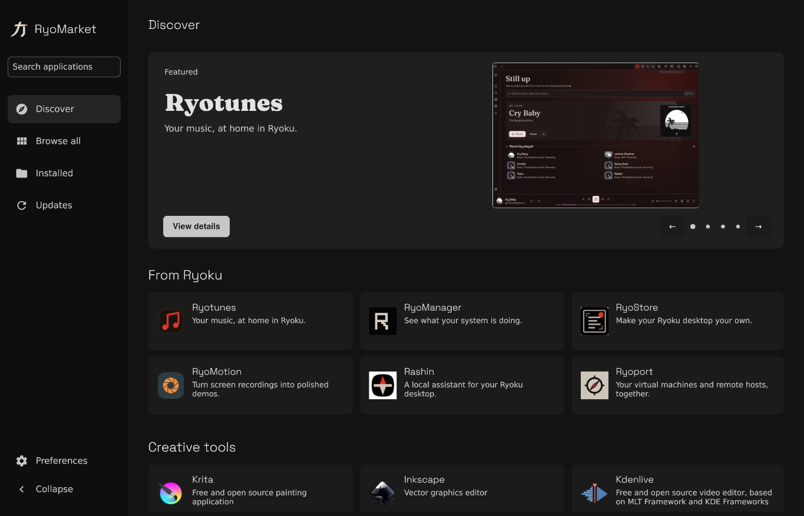

# RyoMarket

Software discovery and application management for Ryoku.



Discover curated applications, explore the full catalogue, compare installation methods and manage installed software. RyoMarket follows your desktop appearance, with optional dark and light themes.

## Run

```sh
nix run github:aethctl/ryomarket
```

Install RyoMarket persistently:

```sh
nix profile add github:aethctl/ryomarket
```

Then run `ryomarket` or open RyoMarket from your application launcher. Nix must have `nix-command` and `flakes` enabled. For a one-off launch without changing Nix settings:

```sh
nix --extra-experimental-features 'nix-command flakes' run github:aethctl/ryomarket
```

## Ryoku applications

Ryotunes, RyoManager, RyoStore, RyoMotion, Rashin and Ryoport have independent packages. They are installed on demand and are not dependencies of RyoMarket itself. These application packages currently target NixOS on x86_64 Linux. Ryogami remains an essential desktop component.

Each listing offers:

| Method | Ownership |
| --- | --- |
| Nix flake | A pinned, persistent profile managed by RyoMarket, with desktop and command integration |
| Nix profile | Your normal user Nix profile |
| Nix configuration | A reproducible package expression for your configuration, rebuilt when you choose |

For a one-command application installation:

```sh
nix run github:aethctl/ryomarket#install-ryotunes
```

Replace `ryotunes` with `ryomanager`, `ryostore`, `ryomotion`, `rashin` or `ryoport`. To remove that managed installation:

```sh
nix run github:aethctl/ryomarket#install-ryotunes -- --remove
```

`nix run github:aethctl/ryomarket#ryotunes` launches the standalone package without persistently installing it.

The Ryotunes and Rashin launchers start their bundled backends when needed. Spotify requires sign-in and the optional Soloist setup. Rashin needs a configured model provider. VM permissions, GPU passthrough and remote credentials remain explicit system or user choices.

## NixOS configuration

Add the flake input:

```nix
inputs.ryomarket.url = "github:aethctl/ryomarket";
```

Import `ryomarket.nixosModules.default` in your `nixosSystem.modules` list, then set:

```nix
programs.ryomarket.enable = true;
```

This installs the marketplace and its desktop entry. It does not install the optional apps, enable background services or install the privileged configuration helper. See [Nix packaging](docs/NIXOS-PACKAGING.md) for direct package declarations and available outputs.

## Other software

The catalogue supports native packages on Fedora, Arch/CachyOS and Void, plus Nix profiles, Flatpak, managed AppImages and curated upstream archives where compatible. Availability follows the detected host. Package changes have an explicit transaction preview and confirmation.

Version 0.2.0 is a beta. NixOS x86_64 has received the most testing. The client also has an aarch64-linux flake output, but the optional Ryoku application set is currently x86_64-only.

## Development

```sh
nix develop
make test
make vet
python3 scripts/test-flake-installer.py
nix build
```

The project uses Go 1.23.2 or newer and Gio. The Nix development shell provides the native build dependencies. Architecture and catalogue details are in [docs/ARCHITECTURE.md](docs/ARCHITECTURE.md) and [docs/CATALOG.md](docs/CATALOG.md).

RyoMarket follows XDG paths. Managed flake installations live under `$XDG_STATE_HOME/ryomarket/flake-apps`, with desktop entries in `$XDG_DATA_HOME/applications` and commands in `$XDG_BIN_HOME` or `~/.local/bin`. Failed builds keep the working generation. Removal preserves application data and credentials and refuses to replace unrelated files.

## License

GNU GPL version 3. Space Grotesk and Fraunces are bundled under their included SIL Open Font Licenses. See [asset credits](docs/ASSETS.md).
